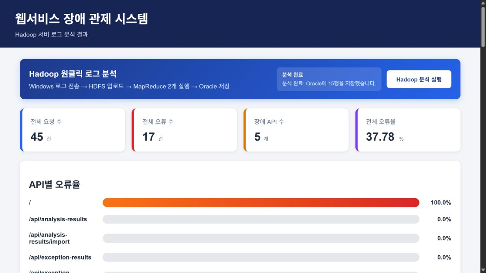

# JHZZAng12

**Backend & Systems Automation**

## Tech Stack

- **백엔드** · Java, Spring Boot, Python, FastAPI
- **웹·데이터베이스** · TypeScript, Next.js, PostgreSQL, Oracle, Supabase
- **로그 분석·개발 자동화** · Hadoop, Git, GitHub Actions, Vitest, Playwright

## Core Skills

- **로그 분석 자동화** — 웹서비스 장애 관제에서 분석 버튼을 누르면 로그를 HDFS에 올리고, MapReduce로 집계해 Oracle에 저장합니다. 저장이 끝나면 대시보드에 새 결과가 표시됩니다.
- **테스트 자동화** — 계약안심에서 `main`에 코드를 올리거나 `main`으로 PR을 보내면 GitHub Actions에서 단위 테스트, 빌드, 타입 검사, 브라우저 테스트가 차례로 실행됩니다.
- **AI 검토와 오류 재현** — SelDi에서 증상이 빠진 요청을 보내면 이력이 저장되지 않는 문제를 Codex와 재현했습니다. 요청에 증상을 포함하도록 고친 뒤 같은 조건에서 저장을 확인했습니다.
- **회귀 테스트** — 계약안심의 AI 코드 리뷰 이후 예제 PDF를 다시 분석해 조항이 두 번 집계되는 문제를 찾았습니다. PDF 제목을 첫 조항과 분리하고, 조항 번호를 빼면 같은 인용은 한 번만 집계하도록 고쳤습니다. 관련 회귀 테스트 2개를 로컬에서 통과했습니다.

## Featured Projects

| 프로젝트 | 주요 기능 | 링크 |
| --- | --- | --- |
| **웹서비스 장애 관제** | API별 요청 수와 오류율을 대시보드에 표시하고, 사용자 제보를 함께 보여줍니다. | [시연 영상](https://youtu.be/CIOXdKjb7LM) |
| **SelDi** | 제품 사진과 증상에서 AI가 단서를 찾고, 진단 규칙에 따라 고장 원인 후보와 조치 방법을 안내합니다. | [서비스 보기](https://seldi-fresh-frontend.vercel.app/) |
| **계약안심** | 계약서 PDF에서 주의할 조항을 찾아 원문 인용과 함께 보여줍니다. | [서비스 보기](https://youth-housing-risk-ai-frontend.vercel.app/) |

## Developer Tools

**Git Auto Backup** · Python, Git

Python 파일을 2초마다 확인합니다. 30초 동안 추가 변경이 없으면 자동으로 커밋하고 GitHub에 올립니다. 푸시에 실패하면 30초 뒤 다시 시도합니다. [공개 코드](https://github.com/JHZZAng12/git-auto-backup)

## Education & Certifications

- 대전대학교 컴퓨터공학과
- HRD 빅데이터 기반 AI 물류 자동화 시스템 개발 과정
- 초경량비행장치 조종자(1종)
